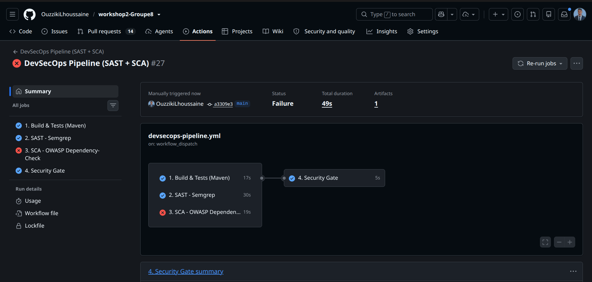
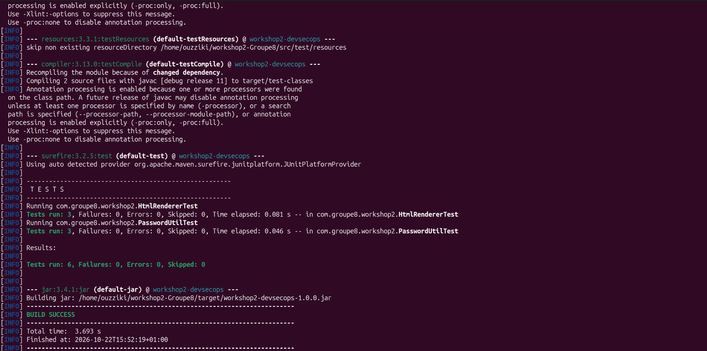
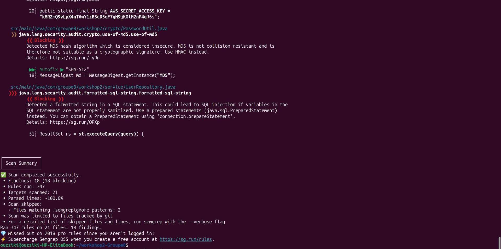
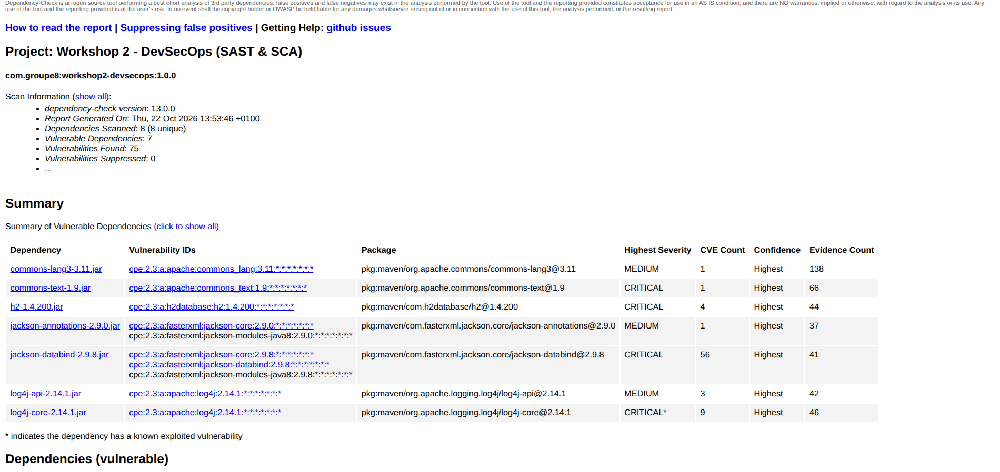
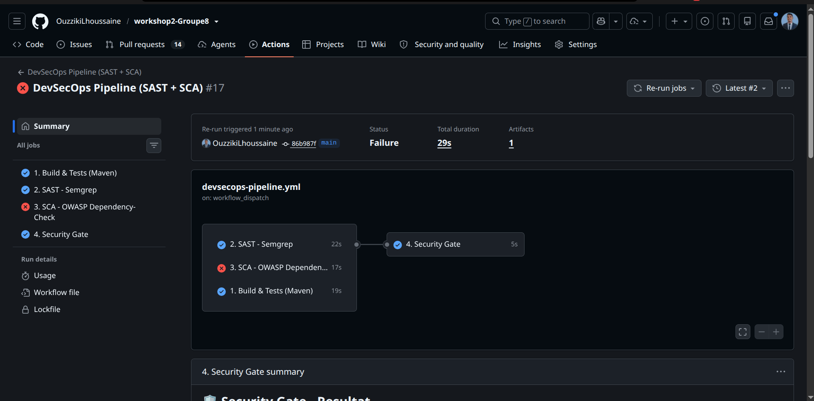
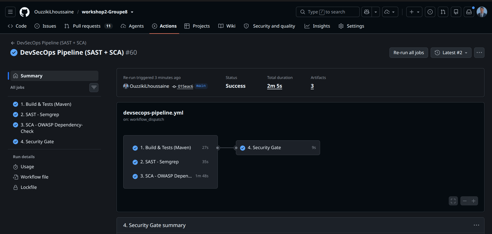
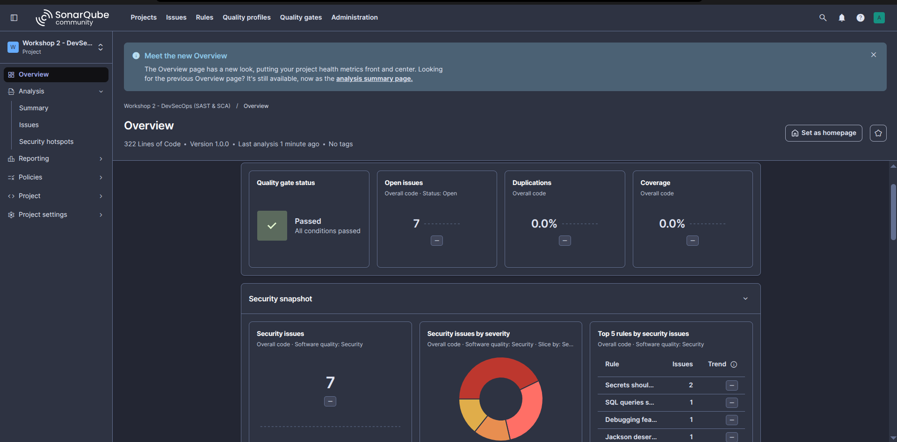
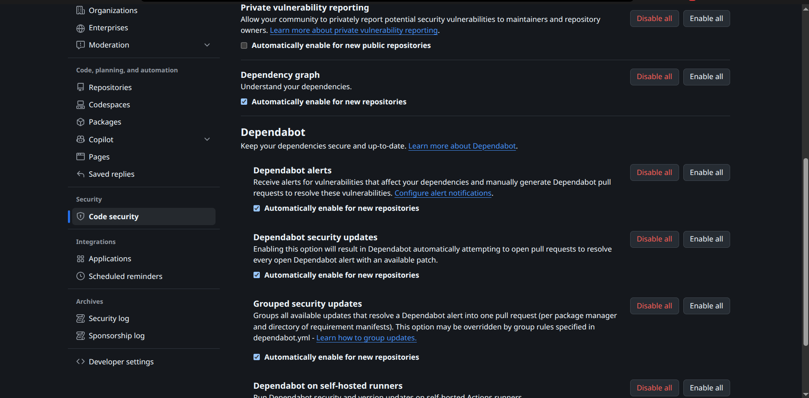

# 🛡️ Workshop 2 — DevSecOps (Chapitres 2 & 3) — Groupe 8

[](../../actions/workflows/devsecops-pipeline.yml)
[](https://openjdk.org/)
[](https://maven.apache.org/)

> **Sécurité du code source (SAST) & Sécurité des dépendances (SCA)**
> Projet pédagogique contenant des **vulnérabilités intentionnelles**, détectées puis
> corrigées à l'aide d'une pipeline DevSecOps.

---

## 📋 Sommaire

1. [Objectifs du workshop](#-objectifs-du-workshop)
2. [Présentation du projet](#-présentation-du-projet)
3. [Démarrage rapide](#-démarrage-rapide)
4. [La pipeline CI/CD](#-la-pipeline-cicd)
5. [Partie A — SAST : Semgrep & SonarQube](#-partie-a--sast--semgrep--sonarqube)
6. [Partie B — SCA : Dependabot & OWASP Dependency-Check](#-partie-b--sca--dependabot--owasp-dependency-check)
7. [Rapport](#-rapport)
8. [Captures d'écran](#-captures-décran)
9. [Guide pas à pas (GitHub → Classroom)](#-guide-pas-à-pas)
10. [Checklist de soumission](#-checklist-de-soumission)

---

## 🎯 Objectifs du workshop

| Chapitre | Thème | Outils | Objectif |
|---|---|---|---|
| **2** — Sécurité du code source | **SAST** (Static Application Security Testing) | **SonarQube** (Docker), **Semgrep** | Détecter injections, XSS, mauvaises pratiques ; comprendre les limites et complémentarités des outils |
| **3** — Sécurité des dépendances | **SCA** (Software Composition Analysis) | **Dependabot**, **OWASP Dependency-Check** | Détecter les CVE des bibliothèques (Log4Shell…) et automatiser les mises à jour |

**Compétences travaillées :** OWASP Top 10 (2025), pipeline SAST avec security gates,
analyse taint/patterns/règles, inventaire de dépendances, CVSS, Shift-Left.

---

## 🧱 Présentation du projet

Application **Java / Maven** simulant un petit espace utilisateur (recherche, profil,
gabarits de messages). Elle contient **9 vulnérabilités intentionnelles** et
**4 dépendances volontairement vulnérables** :

### Vulnérabilités de code (SAST)

| # | Classe | Vulnérabilité | Référence |
|---|---|---|---|
| 1 | `service/UserRepository.java` | **Injection SQL** (concaténation dans la requête) | CWE-89, OWASP A05 |
| 2 | `service/SearchService.java` | **Injection de logs** + contexte **Log4Shell** | CVE-2021-44228 |
| 3 | `web/HtmlRenderer.java` | **XSS** (HTML sans échappement) | CWE-79 |
| 4 | `web/CommandRunner.java` | **Command Injection** (`Runtime.exec`) | CWE-78, OWASP A05 |
| 5 | `config/Credentials.java` | **Secrets hardcodés** (password, clés API) | CWE-798, OWASP A02 |
| 6 | `crypto/PasswordUtil.java` | **Crypto faible** (MD5 pour mots de passe) | CWE-328, OWASP A04 |
| 7 | `config/JsonConfigLoader.java` | **Désérialisation non sûre** (`enableDefaultTyping`) | CWE-502, OWASP A08 |
| 8 | `web/MessageTemplate.java` | **Text4Shell** (substitution non fiable) | CVE-2022-42889 |
| 9 | `web/ErrorHandler.java` | **Mauvaise gestion des erreurs** (stack trace exposée, exceptions avalées) | OWASP A09/A10 |

### Dépendances vulnérables (SCA)

| Bibliothèque | Version | Vulnérabilité |
|---|---|---|
| `log4j-core` | 2.14.1 | **CVE-2021-44228 (Log4Shell)** — CVSS 10.0 |
| `commons-text` | 1.9 | **CVE-2022-42889 (Text4Shell)** — CVSS 9.8 |
| `jackson-databind` | 2.9.8 | Failles de désérialisation polymorphe |
| `h2` | 1.4.200 | CVE connues (contournement d'authentification) |

### Arborescence

```
workshop2-Groupe8/
├── pom.xml                          # Maven (dépendances vulnérables volontaires)
├── docker-compose.yml               # SonarQube Community (SAST local)
├── README.md                        # ← Ce rapport
├── .github/
│   ├── workflows/
│   │   └── devsecops-pipeline.yml   # ← Pipeline CI/CD (Build → SAST → SCA → Gate)
│   └── dependabot.yml               # ← Mises à jour auto des dépendances
├── scripts/
│   └── security_gate.py             # Risk acceptance gate (politique de sécurité)
├── docs/
│   ├── CORRECTIONS.md               # Correctifs appliqués (avant/après)
│   └── screenshots/                 # Captures d'écran du rapport
└── src/
    ├── main/java/com/groupe8/workshop2/
    │   ├── App.java
    │   ├── service/    (UserRepository, SearchService)
    │   ├── web/        (HtmlRenderer, CommandRunner, MessageTemplate, ErrorHandler)
    │   ├── config/     (Credentials, JsonConfigLoader)
    │   └── crypto/     (PasswordUtil)
    └── test/java/…                    # Tests unitaires (méthodes sûres)
```

---

## ▶️ Démarrage rapide

Prérequis : **JDK 17**, **Maven 3.9+**, **Git**, **Docker** (pour SonarQube).

```bash
# 1. Compiler + tester (doit passer sans erreur ✔)
mvn clean verify

# 2. Lancer SonarQube (SAST local)
docker compose up -d          # http://localhost:9000  (admin/admin)

# 3. Analyser le code avec SonarQube
mvn -Psonar sonar:sonar -Dsonar.host.url=http://localhost:9000 \
    -Dsonar.login=admin -Dsonar.password=VOTRE_NOUVEAU_MDP

# 4. Analyser les dépendances (SCA) — rapport dans target/dependency-check-report.html
mvn -Psecurity-sca dependency-check:check

# 5. Scan Semgrep local (optionnel, identique au job CI)
pip install semgrep
semgrep scan --config p/owasp-top-ten --config p/security-audit --config p/secrets .
```

---

## 🔄 La pipeline CI/CD

Workflow : [`devsecops-pipeline.yml`](.github/workflows/devsecops-pipeline.yml) — exécuté
à chaque `push` / `pull_request` sur `main` (et via *Run workflow*).

```
   push / PR
      │
      ▼
┌──────────────────────┐
│ 1. Build & Tests     │  mvn clean verify  → compilation sans erreur ✔
└──────────┬───────────┘
           ▼
┌──────────────────────┐
│ 2. SAST — Semgrep    │  p/owasp-top-ten + p/security-audit + p/secrets
└──────────┬───────────┘   rapports JSON + SARIF (onglet Security)
           ▼
┌──────────────────────┐
│ 3. SCA — Dependency- │  CVE des librairies (NVD) → rapport HTML/JSON
│    Check (OWASP)     │
└──────────┬───────────┘
           ▼
┌──────────────────────┐
│ 4. SECURITY GATE     │  Politique : 0 CRITICAL, ≤ 5 HIGH, 0 secret
└──────────┬───────────┘   ❌ FAIL = risque inacceptable → corriger
           ▼
     ✅ PASS / déploiement
```

| Job | Outil | Rôle |
|---|---|---|
| `build-and-test` | Maven + JUnit | Vérifie que **le projet compile sans erreur** et que les tests passent |
| `sast-semgrep` | Semgrep | Analyse statique : injection, XSS, crypto faible, secrets… |
| `sca-dependency-check` | OWASP Dependency-Check | Recherche les **CVE** des dépendances (base NVD) |
| `security-gate` | `scripts/security_gate.py` | **Risk acceptance gate** : bloque le build si le risque est trop élevé |

> 💡 **Shift Left** : chaque nouveau commit relance automatiquement le pipeline
> (ré-scan) jusqu'à ce que le code passe le gate.

---

## 🧪 Partie A — SAST : Semgrep & SonarQube

### Semgrep (dans la pipeline GitHub Actions)

Le job `sast-semgrep` exécute 3 règles :
- `p/owasp-top-ten` — violations de l'OWASP Top 10
- `p/security-audit` — patterns dangereux (command injection, désérialisation, MD5…)
- `p/secrets` — clés API / tokens commités

Les résultats sont visibles dans le **job log**, en **artefact** (`semgrep-report`)
et dans l'onglet **Security → Code scanning** (dépôt public).

### SonarQube (local, via Docker)

```bash
docker compose up -d                                   # démarre SonarQube
mvn -Psonar sonar:sonar -Dsonar.host.url=http://localhost:9000 \
    -Dsonar.login=admin -Dsonar.password=VOTRE_MDP
```

Puis ouvrir **http://localhost:9000 → projet `com.groupe8:workshop2-devsecops`** :
- **Issues / Security Hotspots** : SQLi (S2077), command injection (S2076),
  mots de passe hardcodés (S2068), MD5 (S4790), `printStackTrace` (S1148)…
- **Security Gate / Quality Gate** du projet.

### 🔎 Comparaison des deux outils (à compléter avec vos résultats)

| Critère | SonarQube | Semgrep |
|---|---|---|
| Type d'analyse | Règles + hotspots qualité/sécurité (Java) | Pattern matching + taint (multi-langages) |
| Installation | Serveur (Docker) | Une commande / une image Docker |
| Intégration CI | Via `sonar-maven-plugin` (sonar-scanner) | Via image `semgrep/semgrep` |
| Points forts | Qualité + sécurité, dashboard, quality gate | Rapide, règles OWASP, détection de secrets |
| Limites | Taint limité sans configuration avancée | Faux positifs, ne détecte pas tout |
| Findings trouvés ici | … | … |

---

## 📦 Partie B — SCA : Dependabot & OWASP Dependency-Check

### Dependabot (Chapitre 3)

Fichier : [`.github/dependabot.yml`](.github/dependabot.yml) — vérifie chaque semaine
`pom.xml` + les GitHub Actions, et **ouvre automatiquement des Pull Requests** de mise à jour.

Activation des alertes : **Settings → Code security → Dependency graph /
Dependabot alerts / Dependabot security updates** (tout activer ✔).

### OWASP Dependency-Check

```bash
mvn -Psecurity-sca dependency-check:check
# → target/dependency-check-report.html  (CVSS, CVE, recommandations)
```

Le job CI `sca-dependency-check` produit le même rapport (artefact `dependency-check-report`).
💡 Pour éviter le *rate limiting* de la NVD : créer un token sur
[nvd.nist.gov](https://nvd.nist.gov/developers/get-an-api-key) et l'ajouter comme
**secret** `NVD_API_KEY` du dépôt (*Settings → Secrets and variables → Actions*).

### CVE détectées (attendues)

| CVE | Bibliothèque | CVSS | Gravité |
|---|---|---|---|
| CVE-2021-44228 (Log4Shell) | log4j-core 2.14.1 | 10.0 | 🔴 Critique |
| CVE-2022-42889 (Text4Shell) | commons-text 1.9 | 9.8 | 🔴 Critique |
| CVE-2022-23221 (+ autres) | h2 1.4.200 | 9.8 | 🔴 Critique |
| CVE désérialisation | jackson-databind 2.9.8 | 5.x–8.x | 🟠 High |

---

## 📝 Rapport

### 1. Méthodologie

1. Création d'un projet Maven contenant des vulnérabilités **intentionnelles** (cf. tableau ci-dessus).
2. Mise en place d'une **pipeline CI/CD** (GitHub Actions) : Build/Tests → **SAST** → **SCA** → **Security Gate**.
3. Analyse du code avec **Semgrep** (CI) et **SonarQube** (Docker local).
4. Analyse des dépendances avec **OWASP Dependency-Check** et **Dependabot**.
5. **Correction** des vulnérabilités ([`docs/CORRECTIONS.md`](docs/CORRECTIONS.md)) puis re-scan automatique.

### 2. Résultats SAST (Semgrep / SonarQube)

**Exemple de résultats (scan local Semgrep — packs `p/owasp-top-ten`, `p/security-audit`, `p/secrets`) : 18 findings**, dont **4 sur le code applicatif** :

| Sévérité | Règle | Localisation | Vulnérabilité |
|---|---|---|---|
| 🔴 ERROR | `formatted-sql-string` | `UserRepository.java:51` | Injection SQL |
| 🔴 ERROR (secret) | `detected-aws-access-key-id-value` | `Credentials.java:19` | Clé AWS hardcodée |
| 🔴 ERROR (secret) | `detected-aws-secret-access-key` | `Credentials.java:20` | Secret AWS hardcodé |
| 🟠 WARNING | `use-of-md5` | `PasswordUtil.java:18` | Crypto faible (MD5) |

+ **14 warnings de durcissement** (tags d'actions GitHub mutables dans le workflow,
cooldown Dependabot manquant…).

**Remarque comparative (objectif du workshop — limites & complémentarité) :**
Semgrep n'a **pas** remonté le XSS ni la command injection avec ces packs de règles.
SonarQube, via ses *security hotspots* (S2076 command injection, S5131 XSS…),
vient compléter l'analyse. Chaque outil a ses forces : **les utiliser ensemble**
couvre davantage de risques. Complétez le tableau comparatif avec vos propres résultats.

### 3. Résultats SCA (Dependency-Check / Dependabot)

- OWASP Dependency-Check : **…** CVE (dont **Log4Shell CVSS 10.0**).
- Dependabot : **…** alertes / PRs de mise à jour générées automatiquement.

### 4. Corrections apportées

Résumé des correctifs (détails code avant/après dans [`docs/CORRECTIONS.md`](docs/CORRECTIONS.md)) :

| Vulnérabilité | Correctif |
|---|---|
| Injection SQL | `PreparedStatement` + requêtes paramétrées |
| XSS | Échappement HTML systématique (`escapeHtml`) |
| Command Injection | `ProcessBuilder` avec liste d'arguments + liste blanche d'hôtes |
| Secrets hardcodés | Variables d'environnement / secret store |
| MD5 | SHA-256 + sel (BCrypt recommandé pour mots de passe) |
| Désérialisation | Suppression de `enableDefaultTyping`, validation des types |
| Log4Shell | montée de version `log4j-core` **2.17.1+** |
| Text4Shell | montée de version `commons-text` **1.10.0+** |
| Gestion des erreurs | Journalisation + message d'erreur générique côté client |

### 5. Le Security Gate en action

1. **1er commit** (code vulnérable) → le job `security-gate` est en **❌ FAIL**
   (2 vulnérabilités critiques SCA + secrets + findings SAST).
2. Application des corrections → **nouveau commit** → le pipeline se relance
   (ré-scan automatique / Shift Left).
3. **2e run** → `security-gate` en **✅ PASS**.

### 6. Conclusion

Ce workshop montre l'intérêt d'une approche **DevSecOps** :
- le **SAST** (Semgrep/SonarQube) détecte les failles de code **avant le build** ;
- le **SCA** (Dependency-Check/Dependabot) traite le risque **supply chain**
  (ex. Log4Shell : une seule bibliothèque peut compromettre tout l'écosystème) ;
- les **security gates** automatisent l'acceptation du risque dans la CI ;
- les deux familles d'outils sont **complémentaires** (pattern matching vs CVE DB).

---

## 📸 Captures d'écran

> Placez vos captures dans [`docs/screenshots/`](docs/screenshots/) puis
> vérifiez les liens ci-dessous.

| # | Capture | Fichier |
|---|---|---|
| 1 | Pipeline complet (vue d'ensemble des 4 jobs) | `01-pipeline-ensemble.png` |
| 2 | Job `build-and-test` ✅ (build sans erreur) | `02-build-tests.png` |
| 3 | Job `sast-semgrep` — findings détectés | `03-semgrep-findings.png` |
| 4 | Job `sca-dependency-check` — CVE détectées | `04-dependency-check-cve.png` |
| 5 | Job `security-gate` ❌ (gate bloquant) | `05-gate-fail.png` |
| 6 | Job `security-gate` ✅ après corrections | `06-gate-pass.png` |
| 7 | Dashboard **SonarQube** (issues / hotspots) | `07-sonarqube-dashboard.png` |
| 8 | **Dependabot** (alertes ou PR de mise à jour) | `08-dependabot-alerte.png` |
| 9 | Rapport **Dependency-Check** (HTML) | `09-rapport-dependency-check.png` |


















---
